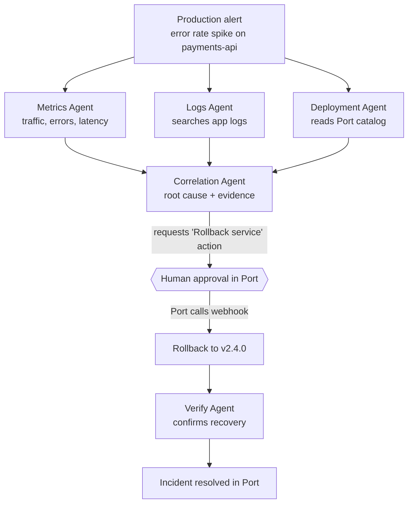

# Agentic incident response with Port

A production alert fires. Three specialist AI agents investigate in parallel, a correlation agent
finds the root cause, and the agents **request** a rollback in Port. A human approves it. The
rollback runs, a verify agent confirms recovery, and the incident closes itself in the catalog.



**What's generic:** the agent pattern (fan-out to narrow specialists, correlate, human gate, act, verify).
**What Port adds:** the context agents can't guess (ownership, dependencies, deployment history),
a governed way to act (self-service action with required approval), and an audit trail
(incident record, run logs, catalog changes tied to the run).


## The control room (recommended for live demos)

One command starts everything, and the whole story plays out in your browser:

```bash
ngrok http 4000          # terminal 1: keep the tunnel up so Port can deliver approvals
npm run demo             # terminal 2: app + customer traffic + agents + control room
```

Then open **http://localhost:5050**.

1. **Pick who's deploying.** Alex Kim or Pavan (change the list with `DEMO_PEOPLE` in `.env`).
2. **Ship v2.4.1.** The deployment is recorded in Port under that person's name, then shipped.
3. **Watch it break.** The live traffic chart turns red: payments drop from ~170/s to ~42/s and a
   quarter of them fail.
4. **Watch the agents.** The alert fires, three agents investigate in parallel, the Correlation
   Agent names the root cause and rules out the noise.
5. **Approve in Port.** Click **Approve the rollback in Port**, approve the run there, and come back.
6. **Watch it recover.** The rollback lands, the chart goes green, the Verify Agent confirms
   recovery and the incident clock stops.

**Reset demo** (top right) puts everything back for the next take, with no restarts. The header
also tells you whether Port can reach your agents through the tunnel, so you know before you
start whether approvals will arrive.

The control room only listens on `127.0.0.1`, so it is never exposed through your tunnel. The
four separate terminals below still work if you prefer them for the recording.

## What's in the box

| Path | What it is |
|---|---|
| `app/` | **payments-api**, the demo service. v2.4.1 ships a bug: the DB connection pool drops from 20 to 2. It exposes its own metrics and logs endpoints, standing in for your observability stack. |
| `agents/` | Five agents on one small, generic tool-use loop (`runAgent.js`). Each has only the tools it needs. |
| `orchestrator/` | Alert watcher, fan-out/fan-in workflow, the Port approval request, and the webhook Port calls once approved. |
| `port/` | Port REST client, blueprint/action definitions, and a one-command setup. |
| `scripts/` | Load generator, simulated CI deploy, and reset for retakes. |
| `docs/RECORDING.md` | Run-of-show for filming the video. |

---

## Step 1 · Prerequisites

- **Node.js 20+**
- **A Port account** where you're an admin (blueprints and actions get created).
- **An OpenAI API key** for the agents. Optional: without one, the agents run in *mock mode* with
  deterministic logic and the same tools, which is handy for rehearsals.
- **A tunnel** so Port can reach your laptop, for example
  [cloudflared](https://developers.cloudflare.com/cloudflare-one/connections/connect-networks/do-more-with-tunnels/trycloudflare/)
  (no account needed) or ngrok.

## Step 2 · Install and configure

```bash
npm install
cp .env.example .env
```

Fill in `.env`:

- `PORT_CLIENT_ID` / `PORT_CLIENT_SECRET`: in Port, open the `…` menu (top right) → **Credentials**.
- `PORT_API_URL` / `PORT_APP_URL`: keep the defaults for EU (`app.port.io`), or switch both to the
  `us.` variants if your org is on `app.us.port.io`.
- `DEMO_ONCALL_EMAIL`: your email. It becomes the service's on-call in the catalog.
- `OPENAI_API_KEY`: your key, or leave empty for mock mode.
- `OPENAI_MODEL`: any OpenAI model with function calling that your key can use (default `gpt-5.2`).

## Step 3 · Start the tunnel

Port needs a public URL for the rollback webhook. In its own terminal:

```bash
cloudflared tunnel --url http://localhost:4000
```

It prints a line like `https://quiet-river-1234.trycloudflare.com`. Put that in `.env`:

```dotenv
PUBLIC_WEBHOOK_URL=https://quiet-river-1234.trycloudflare.com
```

Base URL only: no trailing slash, and don't add `/port/webhook` (setup appends it, so Port calls
`https://quiet-river-1234.trycloudflare.com/port/webhook`). Using ngrok instead? Run `ngrok http 4000`
and use its `https://….ngrok-free.app` URL the same way. Quick-tunnel URLs change on every restart;
when that happens, update `.env` and run `npm run port:action`.

To check it works once `npm run agents` is running: open `<your URL>/health` in a browser and you
should see `{"ok":true,...}`.

## Step 4 · Set up Port

```bash
npm run port:setup
```

This creates, in your Port org:

- **Blueprints** `Service`, `Deployment`, `Incident` (identifiers prefixed `demo_` so they never clash
  with an existing `service` blueprint).
- **Seed data:** four services (`payments-api` plus three neighbours) and the deployment history of
  `payments-api` (v2.3.2, then v2.4.0 three days ago).
- **Action** `Rollback service` on the Service blueprint: webhook backend pointing at your tunnel,
  `requiredApproval: { type: "ANY" }`, email approval notification.

Then, in Port:

1. **Choose approvers.** Open the `Rollback service` action on the Self-service page and set who can
   approve runs in its permissions (yourself, or the Admin role). Without approvers nobody can let
   the rollback through.
2. **(Recommended for the video)** Create catalog pages for **Incidents** and **Deployments**, and
   open the `payments-api` entity page so the relations tab shows its deployments and incidents.

Prefer clicking through the UI? `npm run port:print` prints all the JSON to paste in manually.

## Step 5 · Start everything (3 terminals + the tunnel)

```bash
# Terminal A: the service
npm run app

# Terminal B: steady traffic (watch it stay green)
npm run load

# Terminal C: the incident agents
npm run agents
```

Let traffic run for at least a minute so the agents have a clean baseline to compare against.

## Step 6 · Ship the bad release

```bash
npm run deploy -- 2.4.1 --by alex.kim
```

This is what a CD pipeline would do: ships v2.4.1 to the app and records the deployment in Port.
Within ~15 seconds the load terminal goes red (errors climb, throughput drops) and terminal C fires
the alert:

1. An **Incident** entity appears in Port (`Investigating`) and `payments-api` turns `Degraded`.
2. **Metrics, Logs and Deployment agents run in parallel.** You'll see each tool call. The Deployment
   Agent's calls go to Port: service context and recent deployments.
3. The **Correlation Agent** combines the findings: v2.4.1 shrank the DB pool; the background
   `FRAUD_CHECK_TIMEOUT` errors are noise. The incident gets root cause, confidence, evidence and a
   timeline, and moves to `Awaiting approval`.
4. The agents **request** the `Rollback service` action through Port's API. It doesn't run yet.

## Step 7 · Approve in Port

Open the pending run in Port (from the action's runs, or the approval email) and **approve** it.
Read the reason field first: it carries the root cause and evidence the agents attached.

Port then calls your webhook (signed, verified by the orchestrator), and:

1. The rollback ships v2.4.0. In the catalog, the v2.4.1 deployment becomes `Rolled back` and a new
   `rollback` deployment is `Live`. All of these changes are tied to the action run.
2. The run log streams progress.
3. After `VERIFY_WAIT_SECONDS` (default 30) the **Verify Agent** checks the metrics since the rollback.
4. If recovered: incident → `Resolved`, service → `Healthy`, run → `SUCCESS`. Load terminal is green again.

Every run also records the numbers the **Agentic Incident Response** dashboard reads: time to detect
(bad deploy → alert), time to approve (rollback requested → human approval), time to recover
(alert → verified recovery), error rate and p99 before and after, who approved, and the rollback run.

## Step 8 · Reset for another take

```bash
npm run reset
```

Puts the app back on v2.4.0, deletes the live-demo incident and its deployments, and marks the
service Healthy. Sample history (incidents with Source `Sample history`, deployments whose identifier
ends in `-sample`) is kept, so the dashboard still has data to compare against. Restart
`npm run agents` before the next take.

---

## Troubleshooting

| Symptom | Fix |
|---|---|
| `Port auth failed` | Check client ID/secret, and that `PORT_API_URL` matches your region. |
| Alert never fires | Is `npm run load` running? Lower `ALERT_ERROR_RATE`, or raise `LOAD_CONCURRENCY` (more traffic = more pool contention). |
| Approved, but nothing happens | The tunnel URL changed or is down. Update `PUBLIC_WEBHOOK_URL`, run `npm run port:action`, then check the run's page in Port for the delivery error. |
| `Rejected webhook with an invalid Port signature` | `PORT_CLIENT_SECRET` must be the secret of the org that sends the webhook. `VERIFY_PORT_SIGNATURE=false` only for debugging. |
| Agent returned non-JSON, or a model error | Check `OPENAI_MODEL` is a model your key can use with function calling. Non-JSON is rare; Rerun with `npm run investigate`, or rehearse in mock mode (`AGENT_MODE=mock`). |
| Want to rerun the investigation without redeploying | `npm run investigate` runs the agents immediately, skipping the alert watcher. |

## Taking it further

- **Real signals instead of the demo app.** Bring Datadog, New Relic, Sentry or PagerDuty data into
  Port with its integrations, and point the Metrics and Logs agents' tools at the catalog instead
  of the demo endpoints. The agents' code barely changes, because each one only knows its tools.
- **A real deploy backend.** Swap the webhook for a GitHub Actions or Argo CD backend on the
  `Rollback service` action. The approval step stays exactly the same.
- **Port-native agents.** Recreate the specialists as Port AI agents, or give any coding agent the
  Port MCP server so it can query the same catalog.
- **Production hardening.** Use the Port execution agent instead of a public webhook, and approvals
  by team or role tied to the service owner.
